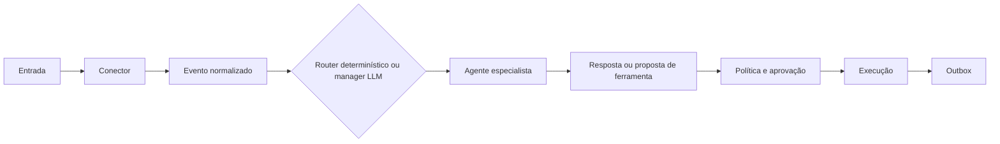

# Arquitetura

ChiefAI / Personal Agent Core usa DDD pragmático e ports/adapters num único processo Spring Boot. Os agentes são lógicos, não microserviços.



## Dashboard financeiro

```text
Gmail
→ extração da fatura/despesa
→ validação
→ PostgreSQL
→ APIs do backend
→ dashboard ChiefAI
→ exportação manual .xlsx quando o utilizador pede
```

PostgreSQL é a fonte de verdade financeira. Não existe worker de sincronização automática para Google Sheets/Excel.

## Módulos

- `api`: controllers, DTOs HTTP e mapeamento.
- `application`: casos de uso, transações curtas e coordenação.
- `domain`: estados, value objects, invariantes e contratos sem Spring/JPA.
- `infrastructure`: JPA, clients HTTP e adapters externos.
- `dashboard`: shell frontend, módulos e endpoints de resumo.

Controllers não chamam repositories diretamente e nunca devolvem entidades JPA.

## Atualização de dados

Quando uma despesa é committed, é registada uma entrada em `finance_dashboard_update`. O frontend usa polling controlado para refetch dos dados financeiros.

## Segurança

O LLM não recebe credenciais nem executa integrações diretamente. Ferramentas externas continuam sujeitas a políticas de agente e aprovação humana.

O dashboard usa sessão Spring Security para um único utilizador `OWNER`. Webhooks usam secrets próprios e não dependem da sessão web.

## Telegram Como Canal Do Manager

```text
Telegram webhook
→ validação do secret e do OWNER
→ IncomingEvent TELEGRAM idempotente por update_id
→ processamento assíncrono
→ router determinístico ou Manager
→ agente(s)
→ notification_outbox
→ TelegramReplyGateway
```

`/health`, `/finance`, `/rucodel`, `/work` e `/personal` usam routing determinístico. Texto sem comando pode usar o Manager fake/LLM para uma ou mais rotas.
